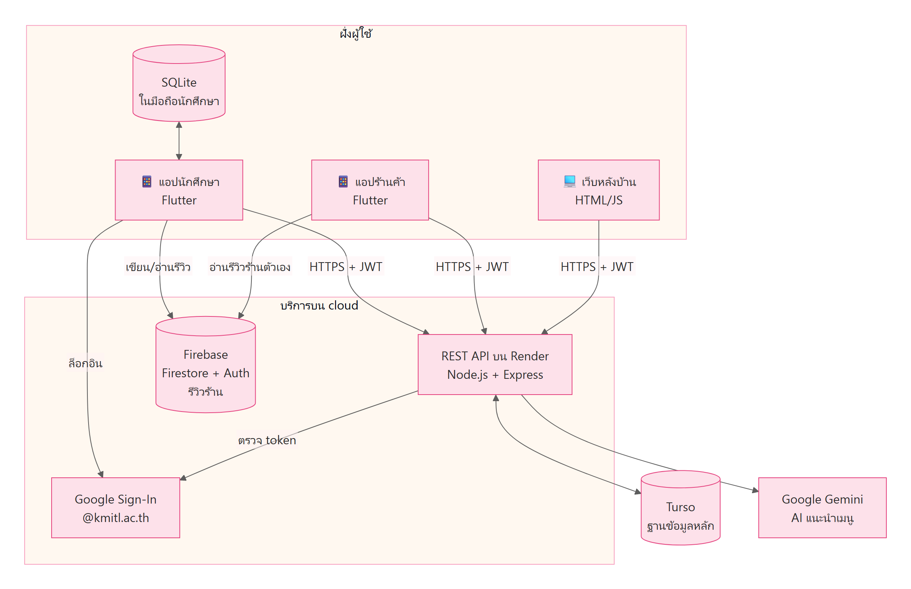
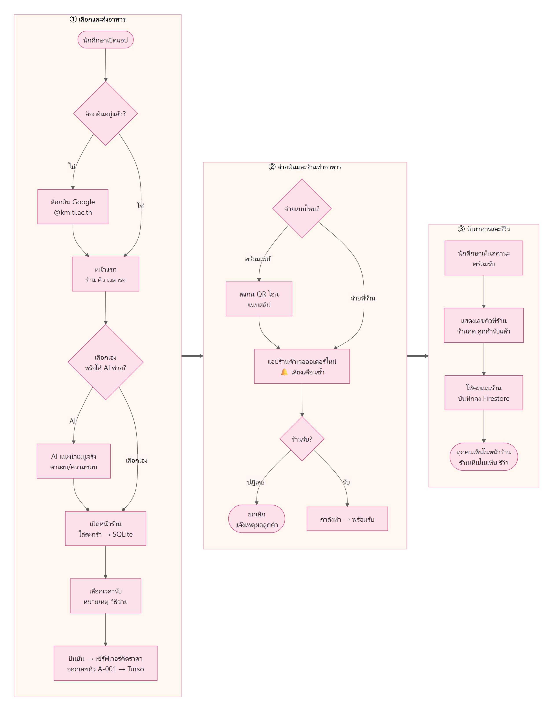

# FoodCourt SIET

[](https://github.com/Num-Pawin166/FoodCourtSIET-V0.1/actions/workflows/ci.yml)

ระบบสั่งอาหารล่วงหน้าของศูนย์อาหาร SIET – KMITL
นักศึกษาสั่งและจ่ายเงินผ่านแอปล่วงหน้า แล้วมารับอาหารตามเวลาที่เลือกโดยไม่ต้องต่อคิว · ร้านค้ารับออเดอร์ผ่านแอปของร้าน · ผู้ดูแลดูภาพรวมผ่านเว็บ

| | |
|---|---|
| เว็บหลังบ้าน (ร้านค้า / ผู้ดูแล) | https://foodcourt-siet.onrender.com |
| แอปนักศึกษาแบบเว็บ (iPhone / Android) | https://foodcourt-siet.onrender.com/app/ |
| ไฟล์ติดตั้ง Android (APK) | GitHub → **Actions** → รอบล่าสุดที่เขียว → **Artifacts** (`mobile-apk`, `vendor-apk`) |



## ส่วนประกอบ

| ส่วน | ผู้ใช้ | เทคโนโลยี | โฟลเดอร์ |
|---|---|---|---|
| แอปนักศึกษา (Android + เว็บ) | นักศึกษา / บุคลากร | Flutter · Material 3 · SQLite ในเครื่อง | [mobile/](mobile/) |
| แอปร้านค้า "FoodCourt ร้านค้า" (Android) | ร้านค้า | Flutter · Material 3 | [vendor/](vendor/) |
| เว็บหลังบ้าน | ร้านค้า, ผู้ดูแล | HTML / CSS / JS (ไม่ต้อง build) | [backend/public/](backend/public/) |
| REST API + ฐานข้อมูลหลัก | ทุกแอป | Node.js 22.12+ · Express 5 · JWT · libSQL (Turso บน cloud / ไฟล์ SQLite ในเครื่อง) | [backend/src/](backend/src/) |
| AI แนะนำเมนู | นักศึกษา | Google Gemini (มีตัวสำรองแบบกฎ) | [backend/src/routes/ai.js](backend/src/routes/ai.js) |
| รีวิวร้าน | นักศึกษา (เขียน) · ร้านค้า (อ่าน) | Cloud Firestore + Firebase Auth (anonymous) · security rules | [mobile/lib/reviews.dart](mobile/lib/reviews.dart), [vendor/lib/reviews.dart](vendor/lib/reviews.dart), [firestore/](firestore/) |

## เอกสาร

| ไฟล์ | เนื้อหา |
|---|---|
| [docs/PROJECT_SUMMARY.md](docs/PROJECT_SUMMARY.md) | สรุปโปรเจกต์: เทคโนโลยีแต่ละส่วน, Flowchart, ฐานข้อมูล, โครงสร้างโฟลเดอร์ |
| [docs/USER_GUIDE.md](docs/USER_GUIDE.md) | คู่มือการใช้งาน (นักศึกษา / ร้านค้า / ผู้ดูแล) |
| [docs/TESTING.md](docs/TESTING.md) | การทดสอบทั้ง 4 ประเภท + CI + วิธีรันเทสต์เอง |
| [docs/RUBRIC_CHECKLIST.md](docs/RUBRIC_CHECKLIST.md) | เทียบงานกับเกณฑ์การประเมิน + เช็กลิสต์ก่อนนำเสนอ |
| [docs/USABILITY_TEST.md](docs/USABILITY_TEST.md) | แบบฟอร์มรายงาน Usability Testing (SUS) |
| [docs/flowcharts/](docs/flowcharts/) | Flowchart 9 ภาพ (PNG) พร้อมใส่สไลด์ |

## วิธีรัน

```bash
# 1) Backend (ต้องเปิดก่อน)
cd backend
npm install
npm start            # http://localhost:3000  (สร้าง DB + ข้อมูลตัวอย่างให้อัตโนมัติครั้งแรก)
npm run seed         # ล้างข้อมูลทั้งหมดแล้วใส่ข้อมูลตัวอย่างใหม่

# 2) แอปนักศึกษา / แอปร้านค้า
cd mobile            # หรือ cd vendor
flutter pub get
flutter run          # Android emulator จะต่อ http://10.0.2.2:3000 ให้อัตโนมัติ
# มือถือจริง: ใช้ IP ของเครื่องคอมในวง Wi-Fi เดียวกัน
flutter run --dart-define=API_URL=http://192.168.1.10:3000/api
```

เว็บหลังบ้าน: เปิด http://localhost:3000 แล้วเข้าสู่ระบบด้วยบัญชีร้านค้าหรือแอดมิน

### รันบน Android (Android Studio / emulator)
ชื่อโฟลเดอร์ `Year 3, Term 1 work` มีจุลภาค ทำให้ build Android ไม่ผ่าน
ต้องจำลองโฟลเดอร์เป็นไดรฟ์ก่อน (ทำใหม่ทุกครั้งที่รีสตาร์ทเครื่อง) หรือเปลี่ยนชื่อโฟลเดอร์ให้ไม่มีจุลภาคแทนก็ได้
```
subst X: "D:\Year 3, Term 1 work\mobile app\FoodCourt SIET"
```
- **Android Studio**: File → Open → เลือก `X:\mobile` (แอปนักศึกษา) หรือ `X:\vendor` (แอปร้านค้า) → เลือก emulator ด้านบน → กด ▶ Run
- **Terminal**: `cd X:\vendor` แล้วรัน `flutter run`
- ทั้งสองแอปต่อ backend ที่ `http://10.0.2.2:3000` ให้อัตโนมัติ (ต้องรัน backend ก่อน)
- Login ด้วย Google บน Android ต้องสร้าง OAuth client แบบ Android เพิ่ม (ดูหัวข้อ Google ด้านล่าง)

### ตั้งค่า AI (Gemini)
คัดลอก `backend/.env.example` เป็น `backend/.env` แล้วใส่ `GEMINI_API_KEY` (สร้างได้ฟรีที่ https://aistudio.google.com/apikey)
ถ้าไม่ใส่ key หรือ Gemini ใช้งานไม่ได้ ผู้ช่วยจะใช้ตัวแนะนำแบบกฎ (กรองตามงบ เวลา ไม่เผ็ด ไม่กินหมู หมวดอาหาร) แทนอัตโนมัติ
**ห้าม commit ไฟล์ `.env`** (มีอยู่ใน `.gitignore` แล้ว)

### ตั้งค่า Login ด้วย Google (@kmitl.ac.th เท่านั้น)
1. ไปที่ https://console.cloud.google.com → สร้างโปรเจกต์
2. **Google Auth Platform → Branding**: ตั้งชื่อแอปและอีเมลติดต่อ, **Audience**: เลือก External (ระหว่างทดสอบต้องเพิ่มอีเมล @kmitl.ac.th ที่จะใช้ใน Test users)
3. **Clients → Create client → Web application**
   - Authorized JavaScript origins: `http://localhost:5000` (และ URL จริงตอน deploy)
   - คัดลอก Client ID ไปใส่ `GOOGLE_CLIENT_ID=` ใน `backend/.env`
4. (Android) **Create client → Android**: package `th.ac.kmitl.siet.foodcourt_siet` + SHA-1 จาก `cd mobile/android && gradlew signingReport`
   (แอป Android ใช้ Web Client ID จากข้อ 3 อยู่แล้ว ไม่ต้องใส่ Android client ID ที่ไหน แค่สร้างไว้ในโปรเจกต์เดียวกัน)
5. รันเว็บด้วยพอร์ตตายตัวให้ตรงกับข้อ 3: `flutter run -d chrome --web-port 5000`

ระบบตรวจ 2 ชั้น: หน้าเลือกบัญชีของ Google แสดงเฉพาะโดเมน kmitl.ac.th และ backend ตรวจ token ซ้ำว่า `hd = kmitl.ac.th` และอีเมลยืนยันแล้ว
ล็อกอินครั้งแรก ระบบจะสร้างบัญชีให้อัตโนมัติ (ชื่อผู้ใช้ = ส่วนหน้าของอีเมล เช่น `65010001`) ถ้ามีบัญชีรหัสนักศึกษาเดียวกันอยู่แล้ว ระบบจะผูกเข้ากับบัญชีเดิม
การสมัครด้วยรหัสผ่านถูกปิดไว้ แต่ยังล็อกอินด้วยรหัสผ่านได้สำหรับบัญชีร้านค้า แอดมิน และบัญชีทดลอง

### ตั้งค่า Firestore (รีวิวร้าน)
ทั้งสองแอปต่อ Firebase project `foodcourt-siet` ไว้แล้ว (`mobile/lib/firebase_options.dart`, `vendor/lib/firebase_options.dart`) ทำที่ Firebase Console ครั้งเดียว:
1. **Security → Authentication → Get started → Sign-in method → Anonymous → Enable**
2. **Firestore Database → Rules** วางเนื้อหาไฟล์ [firestore/firestore.rules](firestore/firestore.rules) แล้วกด **Publish**
   (หรือ `cd firestore && npm install && npx firebase login && npm run deploy`)

ทดสอบ rules บนเครื่อง: `cd firestore && npm install && npm test` (ต้องมี Java 11+)
รีวิวใช้ได้ในแอป Android เท่านั้น (เว็บยังไม่ได้ลงทะเบียนกับ Firebase จึงไม่แสดงส่วนรีวิว)

### บัญชีทดลอง

| บทบาท | ชื่อผู้ใช้ | รหัสผ่าน | ใช้ที่ |
|---|---|---|---|
| นักศึกษา | `65010001` – `65010005`, `66010010` | `1234` | แอปนักศึกษา |
| ร้านค้า | `shopa` – `shope` (ร้าน A–E) | `1234` | แอปร้านค้า, เว็บหลังบ้าน |
| ผู้ดูแล | `admin` | `admin1234` | เว็บหลังบ้าน |

> ⚠️ รหัสผ่านเหล่านี้เปิดเผยใน repository ก่อนใช้งานจริงต้องเปลี่ยนทั้งหมด

## ฟีเจอร์

**แอปนักศึกษา** (ตามดีไซน์ Figma)
- Login ด้วย Google (เฉพาะ @kmitl.ac.th) หรือด้วยรหัสผ่านสำหรับบัญชีทดลอง
- Home: ค้นหาร้านหรือเมนู, กรองตามหมวด, ดูสถานะร้านเปิด/ปิดและจำนวนคิว
- AI แนะนำอาหาร: แชทบอกงบ เวลา และสิ่งที่อยากกินหรือไม่กิน แล้ว Gemini จะเลือกจากเมนูจริงของร้านที่เปิดอยู่ (เน้นร้านคิวน้อย) กดการ์ดเมนูเพื่อไปที่ร้าน
- Menu: ข้อมูลร้าน (เวลาเปิด-ปิด, เวลารอ, คิวตอนนี้), **คะแนนรีวิวและรีวิวล่าสุด**, เพิ่ม/ลดจำนวน, กดหัวใจเก็บเป็นเมนูโปรด
- ตะกร้า: เลือกช่วงเวลารับอาหาร (ทุก 15 นาที คำนวณจากเวลาเตรียมและเวลาปิดร้าน), หมายเหตุถึงร้าน, เลือกวิธีชำระเงิน (โอนพร้อมเพย์ / จ่ายที่ร้าน)
- ชำระเงิน: QR พร้อมเพย์ของร้านพร้อมยอดเงิน (สแกนได้ทุกแอปธนาคาร) → แนบสลิป → รอร้านยืนยัน ถ้าสลิปไม่ผ่านแนบใหม่ได้
- คำสั่งซื้อ: เลขคิว (เช่น A-027), คิวก่อนหน้า, ไทม์ไลน์สถานะที่อัปเดตทุก 5 วินาที, ยกเลิกได้ถ้าร้านยังไม่รับออเดอร์
- ประวัติ: กด "สั่งอีกครั้ง" เพื่อใส่เมนูเดิมลงตะกร้า และ **⭐ ให้คะแนนร้าน** (1–5 ดาว + ความคิดเห็น แก้ได้) สำหรับออเดอร์ที่รับอาหารแล้ว
- ใช้ได้ตอนออฟไลน์: ตะกร้ายังอยู่หลังปิดแอป, ยังเห็นเลขคิวแม้เน็ตหลุด (เก็บใน SQLite ในเครื่อง)
- บัญชีของฉัน: จำนวนออเดอร์และยอดใช้จ่ายเดือนนี้, เมนูโปรด

**แอปร้านค้า** (`vendor/`, ล็อกอินด้วย `shopa` / `1234`) — 4 แท็บ
- **ออเดอร์:** แยกตามสถานะ (ใหม่ / รับแล้ว / กำลังทำ / พร้อมรับ / ทั้งหมดวันนี้) มีปุ่มเปลี่ยนสถานะ สรุปยอดวันนี้ และสวิตช์เปิด/ปิดร้าน
  - เสียงเตือนออเดอร์ใหม่: ดัง + สั่นซ้ำทุก 3 วินาที และมีแถบแดงทุกแท็บ จนกว่าร้านจะกดรับหรือปฏิเสธออเดอร์ใหม่ครบ (แอปต้องเปิดอยู่)
  - การชำระเงิน: ดูสลิปของลูกค้า แล้วกดยืนยันรับเงินหรือปฏิเสธพร้อมเหตุผล / บันทึกรับเงินสด
- **เมนู:** เพิ่ม แก้ไข ลบ สวิตช์มีขาย/หมด และใส่รูปเมนู (ถ่ายรูปหรือเลือกจากคลังภาพ)
- **รีวิว:** คะแนนเฉลี่ย, จำนวนรีวิวแยกตาม 1–5 ดาว และรีวิวทุกอันจากลูกค้า อัปเดตทันทีเมื่อมีรีวิวใหม่ (อ่านอย่างเดียว)
- **ร้านของฉัน:** รูปร้าน (แสดงในแอปนักศึกษา) ชื่อเจ้าของร้าน เปลี่ยนรหัสผ่าน เวลาเปิด-ปิด เวลารอ คำอธิบายร้าน หมายเลขพร้อมเพย์ และออกจากระบบ

**หลังบ้านร้านค้า (เว็บ)**
- บอร์ดออเดอร์ 4 คอลัมน์ (ใหม่ → รับแล้ว → กำลังทำ → พร้อมรับ) มีเสียงแจ้งเตือนเมื่อมีออเดอร์ใหม่
- ปฏิเสธหรือยกเลิกออเดอร์พร้อมเหตุผล (ลูกค้าเห็นเหตุผลในประวัติ)
- สรุปยอดวันนี้ และรายการออเดอร์ทั้งวัน
- จัดการเมนู: เพิ่ม, แก้ไข, ลบ, ตั้งว่า "หมด"
- ตั้งค่าร้าน: สวิตช์เปิด/ปิดร้าน, เวลาทำการ, เวลารอ

**หลังบ้านผู้ดูแล**
- ภาพรวม: ยอดขายวันนี้และย้อนหลัง 14 วัน, กราฟรายวัน, ยอดแยกตามร้าน, เมนูขายดี
- จัดการร้านค้า: รหัสคิว, หมวด, เวลาทำการ
- จัดการผู้ใช้: เพิ่มบัญชี, ผูกบัญชีร้านค้ากับร้าน, รีเซ็ตรหัสผ่าน, ระงับบัญชี
- ดูออเดอร์ทั้งหมด กรองตามร้าน สถานะ หรือวันที่

## ขั้นตอนการทำงาน



**สถานะออเดอร์**
```
pending ──ร้านรับ──▶ accepted ──เริ่มทำ──▶ cooking ──เสร็จ──▶ ready ──ลูกค้ารับ──▶ completed
   │                    │
   └──── cancelled ◀────┘   (ลูกค้ายกเลิกได้เฉพาะตอน pending, ร้านยกเลิกได้ถึง accepted)
```
- เลขคิวรีเซ็ตทุกวันแยกตามร้าน: `{รหัสร้าน}-{ลำดับ 3 หลัก}` เช่น A-001
- เวลาทั้งหมดคำนวณตามเวลาไทย (Asia/Bangkok)
- Flowchart อื่นๆ (ล็อกอิน, พร้อมเพย์, AI, รีวิว, แอปร้านค้า, CI) อยู่ใน [docs/flowcharts/](docs/flowcharts/)

## ฐานข้อมูล

ระบบใช้ฐานข้อมูล 3 แบบ แต่ละแบบเก็บข้อมูลต่างกัน

| ฐานข้อมูล | อยู่ที่ | เก็บอะไร |
|---|---|---|
| **Turso** (libSQL) | cloud — หรือไฟล์ `backend/data/foodcourt.db` ตอนรันในเครื่อง | ข้อมูลหลัก: ผู้ใช้ ร้าน เมนู ออเดอร์ การชำระเงิน รูปภาพ |
| **Cloud Firestore** | cloud (Google) | รีวิวร้าน (ทุกคนเห็นตรงกัน อัปเดต real-time) |
| **SQLite** (sqflite) | ในมือถือนักศึกษา | ตะกร้า, ออเดอร์ล่าสุด (ดูได้ตอนออฟไลน์), แชต AI — ล้างเมื่อออกจากระบบ |

**ตารางใน Turso**

| ตาราง | คอลัมน์หลัก |
|---|---|
| `shops` | code (ตัวอักษรนำหน้าคิว), name, category, open_time, close_time, prep_min/max, is_open, promptpay_id, รูปร้าน |
| `users` | username, name, password_hash (bcrypt), role (`student`/`vendor`/`admin`), shop_id, อีเมล Google |
| `menu_items` | shop_id, name, description, price, is_available, sort_order, รูปเมนู |
| `orders` | queue_no, order_date, user_id, shop_id, status, pickup_time, note, total, การชำระเงิน, เวลาของแต่ละสถานะ |
| `order_items` | order_id, menu_item_id, name และ price ณ ตอนสั่ง, qty |
| `favorites` | user_id, menu_item_id |
| `images` | รูปเมนู รูปร้าน และสลิป |

**Firestore:** collection `reviews` — doc id `order_<เลขออเดอร์>` (1 ออเดอร์ = 1 รีวิว) เก็บ `shopId`, `orderId`, `rating`, `comment`, `authorName` (ชื่อย่อ), `authorUid`, `updatedAt`

## API (`/api`)

ทุก endpoint ที่ต้องล็อกอินใช้ header `Authorization: Bearer <token>`

| Method | Path | สิทธิ์ | คำอธิบาย |
|---|---|---|---|
| GET | `/health` | — | เช็กว่าเซิร์ฟเวอร์ทำงาน |
| POST | `/auth/login` | — | เข้าสู่ระบบ → `{ token, user }` |
| GET | `/auth/config` | — | `{ google_client_id, allowed_domain }` สำหรับตั้งค่าปุ่ม Google |
| POST | `/auth/google` | — | `{ id_token }` → `{ token, user }` (เฉพาะ @kmitl.ac.th) |
| POST | `/auth/register` | — | ปิดไว้ (เปิดได้ด้วย `ALLOW_PASSWORD_REGISTER=true`) |
| GET | `/auth/me`, `/auth/me/stats` | ทุกคน | ข้อมูลผู้ใช้ / สถิติเดือนนี้ |
| PATCH | `/auth/me` | ทุกคน | แก้ชื่อที่แสดง `{ name }` |
| GET | `/categories` | — | หมวดหมู่ร้าน |
| GET | `/shops?q=&category=` | — | รายชื่อร้าน (ค้นหาทั้งชื่อร้านและชื่อเมนู) |
| GET | `/shops/:id` | — | ร้าน + เมนู + ช่วงเวลารับอาหาร |
| GET | `/shops/:id/slots` | — | ช่วงเวลารับอาหารที่ยังเลือกได้ |
| GET | `/images/:id` | — | รูปเมนู / รูปร้าน (cache ได้นาน) |
| GET/PUT/DELETE | `/favorites[/:menuItemId]` | นักศึกษา | เมนูโปรด |
| POST | `/orders` | นักศึกษา | สร้างออเดอร์ (ราคาคำนวณที่ server) |
| GET | `/orders?scope=active\|history` | นักศึกษา | ออเดอร์ของฉัน |
| GET | `/orders/:id` | นักศึกษา | รายละเอียด + คิวก่อนหน้า |
| POST | `/orders/:id/cancel` | นักศึกษา | ยกเลิก (เฉพาะ pending) |
| GET | `/orders/:id/payment` | นักศึกษา | ยอดเงิน + `qr_payload` พร้อมเพย์ + สถานะการชำระ |
| POST/GET | `/orders/:id/slip` | นักศึกษา | แนบสลิป (body = ไฟล์รูป JPG/PNG/WebP ≤ 2 MB) / ดูสลิปของตัวเอง |
| POST | `/ai/chat` | นักศึกษา | `{ messages: [{ role, text }] }` → `{ reply, items, source }` (`source` = `gemini` หรือ `rules`) จำกัด 10 ครั้ง/นาที/คน |
| GET/PATCH | `/vendor/shop` | ร้านค้า | ข้อมูลร้าน / เปิด-ปิดร้าน |
| POST/DELETE | `/vendor/shop/image` | ร้านค้า | อัปโหลด/ลบรูปร้าน |
| GET | `/vendor/orders?scope=active\|today` | ร้านค้า | ออเดอร์ของร้าน |
| PATCH | `/vendor/orders/:id/status` | ร้านค้า | เปลี่ยนสถานะ `{ status, reason? }` |
| PATCH | `/vendor/orders/:id/payment` | ร้านค้า | `{ action: confirm \| reject, reason? }` |
| GET | `/vendor/orders/:id/slip` | ร้านค้า | ดูสลิปของออเดอร์ในร้าน |
| GET/POST/PATCH/DELETE | `/vendor/menu[/:id]` | ร้านค้า | จัดการเมนู |
| POST/DELETE | `/vendor/menu/:id/image` | ร้านค้า | อัปโหลด/ลบรูปเมนู |
| GET | `/vendor/summary` | ร้านค้า | สรุปยอดวันนี้ |
| GET | `/admin/summary?days=14` | ผู้ดูแล | ภาพรวม |
| GET/POST/PATCH/DELETE | `/admin/shops[/:id]` | ผู้ดูแล | จัดการร้าน (ร้านที่มีประวัติออเดอร์จะลบไม่ได้) |
| GET/POST/PATCH | `/admin/users[/:id]` | ผู้ดูแล | จัดการผู้ใช้ |
| GET | `/admin/orders?shop_id=&status=&date=` | ผู้ดูแล | ออเดอร์ทั้งหมด |

รีวิวไม่ผ่าน API นี้ — แอปอ่าน/เขียน Firestore ตรง โดยมี [security rules](firestore/firestore.rules) คุมสิทธิ์

## เอาขึ้นออนไลน์ฟรี (Render + Turso)

**1) Turso (ฐานข้อมูล)** — https://turso.tech
1. สมัคร (ใช้ GitHub ได้) → **Create Database** ชื่อ `foodcourt-siet` เลือก location **AWS ap-southeast-1 (Singapore)**
2. คัดลอก **Database URL** (`libsql://...turso.io`) และกด **Create Token** เก็บ token ไว้

**2) Render (เซิร์ฟเวอร์)** — https://render.com
1. สมัคร (ใช้ GitHub) → **New → Blueprint** → เลือก repo นี้ (Render อ่าน `render.yaml` ให้เอง)
2. กรอก `TURSO_DATABASE_URL`, `TURSO_AUTH_TOKEN`, `GEMINI_API_KEY`, `GOOGLE_CLIENT_ID` → **Apply**
3. รอ deploy เสร็จ จะได้ URL เช่น `https://foodcourt-siet.onrender.com` (ครั้งแรกระบบสร้างตาราง + ข้อมูลตัวอย่างให้เอง)
4. เปิด `https://<URL>/api/health` ต้องได้ `{"ok":true}` และเว็บหลังบ้านอยู่ที่ `https://<URL>/`
5. หลังจากนี้ทุกครั้งที่ push ขึ้น `main` Render จะ deploy ใหม่ให้อัตโนมัติ

**3) Build แอปให้ชี้ไปที่เซิร์ฟเวอร์จริง**
GitHub Actions build APK ให้ทุกครั้งที่ push อยู่แล้ว (โหลดจาก Artifacts) ถ้าจะ build เองในเครื่อง:
```
cd X:\mobile
flutter build apk --release --dart-define=API_URL=https://<URL>/api
cd X:\vendor
flutter build apk --release --dart-define=API_URL=https://<URL>/api
```
ไฟล์อยู่ที่ `build\app\outputs\flutter-apk\app-release.apk` ส่งเข้ามือถือแล้วติดตั้ง
> APK จาก GitHub กับที่ build ในเครื่องเซ็นด้วยกุญแจคนละชุด ถ้าสลับกันต้อง**ถอนแอปเดิมก่อน**ติดตั้ง

**4) แอปนักศึกษาแบบเว็บ** (เปิดผ่านเบราว์เซอร์ได้ทั้ง iPhone/Android ที่ `https://<URL>/app/`)
Render build Flutter ไม่ได้ จึง build ในเครื่องแล้ว commit ไฟล์ไว้ที่ `backend/public/app/` — ทำใหม่ทุกครั้งที่แก้แอป:
```
cd mobile
flutter build web --release --base-href /app/ --dart-define=API_URL=https://<URL>/api
```
แล้วคัดลอก `mobile/build/web/*` ไปทับ `backend/public/app/` (ลบไฟล์ `*.symbols` ทิ้งได้) แล้ว commit + push
และเพิ่ม `https://<URL>` ใน Authorized JavaScript origins ของ Google OAuth client เพื่อให้ปุ่ม Login ด้วย Google ใช้ได้

**ข้อจำกัดของแพ็กเกจฟรี**
- Render หลับเมื่อไม่มีคนใช้ 15 นาที คนแรกที่เข้าต้องรอ ~30-60 วินาที (แอปรอได้ถึง 70 วินาที)
- ระหว่างแอปร้านค้าเปิดอยู่ เซิร์ฟเวอร์จะไม่หลับ เพราะแอปเช็คออเดอร์ทุก 5 วินาที
- **เปลี่ยนรหัสผ่าน `admin` และบัญชีร้านทันที** ผ่านเว็บหลังบ้าน (ข้อมูลตัวอย่างใช้รหัสที่เปิดเผยใน README)
- รีเซ็ตข้อมูลบน Turso: ใส่ `TURSO_DATABASE_URL` / `TURSO_AUTH_TOKEN` ใน `backend/.env` แล้ว `npm run seed`

## การทดสอบ + CI

| ส่วน | Unit | Widget | Integration | Security | รวม | Coverage |
|---|---|---|---|---|---|---|
| Backend | 20 | — | 51 | 26 | 97 | 99.6% |
| แอปนักศึกษา | 52 | 49 | 7 | 11 | 119 | 94.8% |
| แอปร้านค้า | 19 | 28 | 3 | 7 | 57 | 94.9% |
| Firestore rules (Emulator) | — | — | — | 15 | 15 | — |
| **รวม** | | | | | **288** | |

```bash
cd backend && npm test                   # Backend
cd mobile && flutter test --coverage     # แอปนักศึกษา (หรือ cd vendor)
cd firestore && npm install && npm test  # Firestore rules (ต้องมี Java 11+)
```

GitHub Actions ([ci.yml](.github/workflows/ci.yml)) รันทุกครั้งที่ push / เปิด PR — 4 job: Backend · Firestore rules · Student app · Vendor app
แต่ละ job รันเทสต์ ตรวจ coverage ≥ 70% และแอปทั้งสอง build APK ให้ดาวน์โหลด รายละเอียด: [docs/TESTING.md](docs/TESTING.md)

## โครงสร้างโฟลเดอร์

```
├── backend/          REST API (src/) + เว็บหลังบ้าน (public/) + เทสต์ (test/)
├── mobile/           แอปนักศึกษา (Flutter)
├── vendor/           แอปร้านค้า (Flutter)
├── firestore/        Security rules ของ Firestore + เทสต์บน Emulator
├── docs/             เอกสารทั้งหมด + flowcharts/ (PNG)
├── scripts/          check_coverage.py, render_flowcharts.mjs + ต้นฉบับ Flowchart (flowcharts/*.mmd)
├── .github/workflows/ci.yml
└── render.yaml       ตั้งค่า deploy บน Render
```
รายละเอียดทุกไฟล์: [docs/PROJECT_SUMMARY.md](docs/PROJECT_SUMMARY.md#8-โครงสร้างโปรเจกต์)

## สิ่งที่ยังไม่ได้ทำ (ต่อยอดได้)
- Push notification เมื่ออาหารพร้อม (ตอนนี้แอปดึงสถานะใหม่ทุก 5 วินาที)
- ตรวจสลิปอัตโนมัติ (เช่น SlipOK / EasySlip) แทนให้ร้านตรวจเอง
- รีวิวบนเว็บ (ต้องลงทะเบียน Web app ใน Firebase) และผูกรีวิวกับบัญชีนักศึกษาผ่าน Firebase custom token
- ก่อนใช้งานจริงต้องตั้งค่า `JWT_SECRET` เป็นค่าลับของตัวเอง
