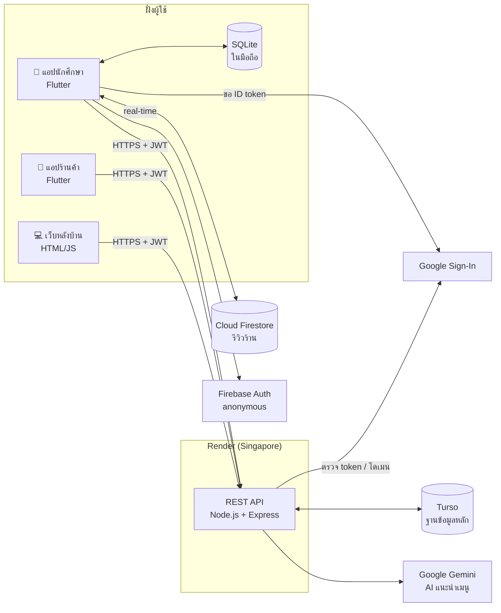
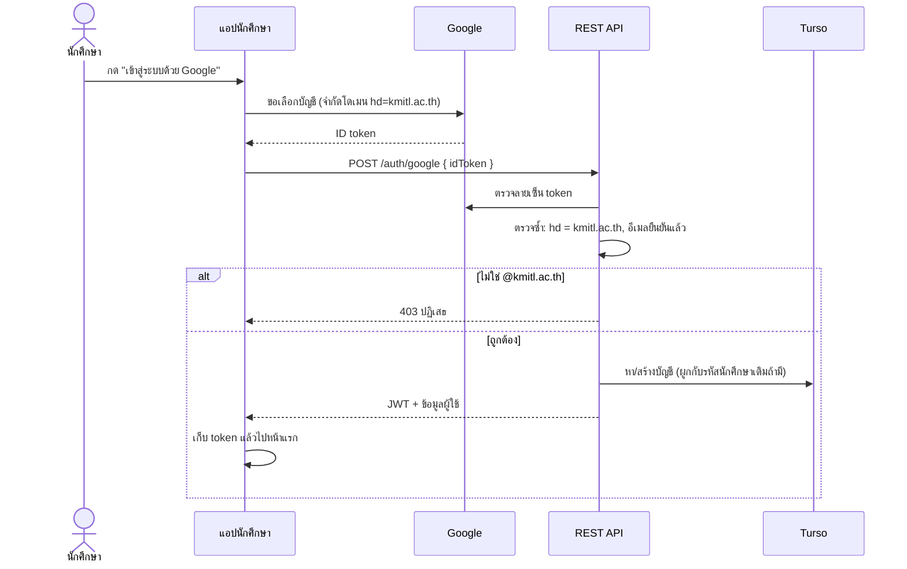
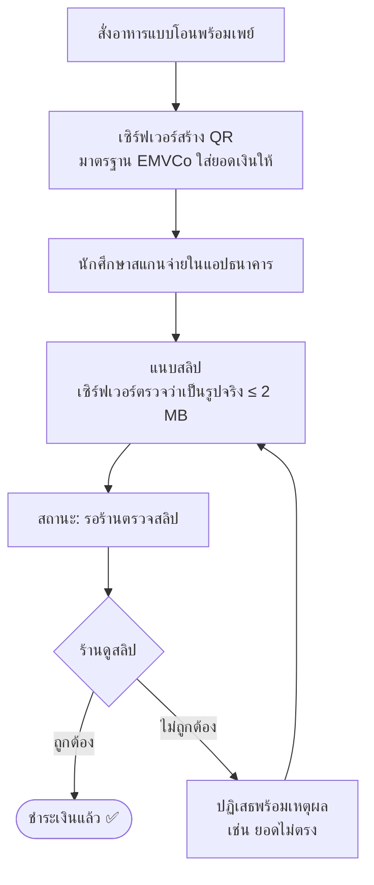
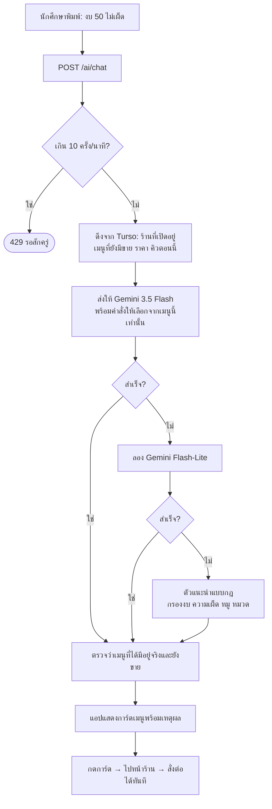
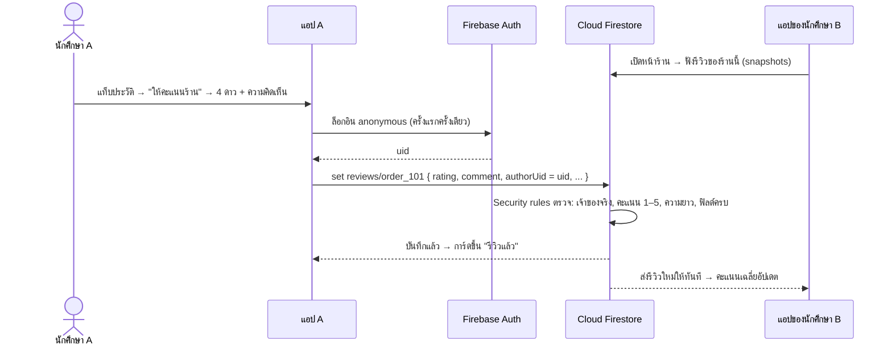
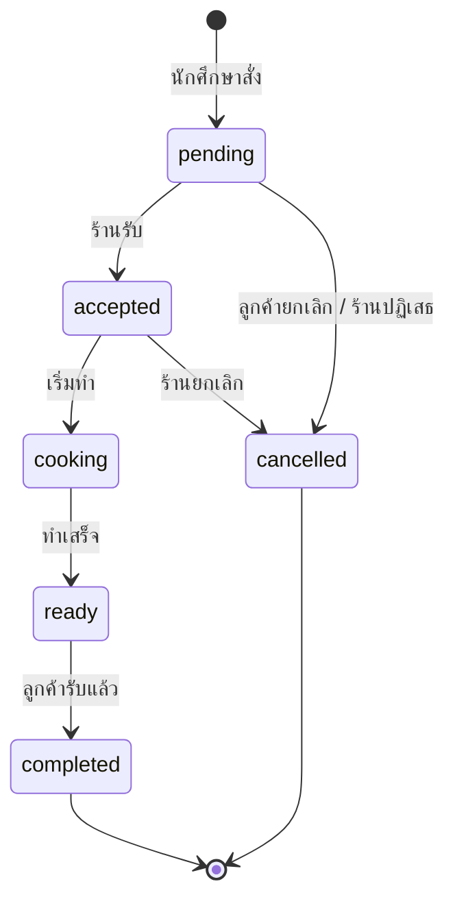
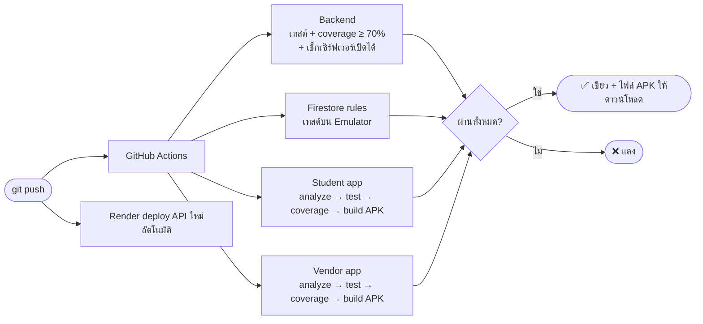

# สรุปโปรเจกต์ FoodCourt SIET

ระบบสั่งอาหารล่วงหน้าสำหรับศูนย์อาหาร SIET – KMITL
นักศึกษาสั่งและจ่ายเงินผ่านแอปได้ล่วงหน้า แล้วมารับอาหารตามเวลาที่เลือกโดยไม่ต้องต่อคิว
ร้านค้ารับออเดอร์และจัดการเมนูผ่านแอปของร้าน ส่วนผู้ดูแลศูนย์อาหารดูภาพรวมผ่านเว็บ

| | |
|---|---|
| เว็บหลังบ้าน (ร้านค้า / ผู้ดูแล) | https://foodcourt-siet.onrender.com |
| แอปนักศึกษาแบบเว็บ | https://foodcourt-siet.onrender.com/app/ |
| Source code | https://github.com/Num-Pawin166/FoodCourtSIET-V0.1 |

> แผนภาพในไฟล์นี้เขียนด้วย Mermaid ซึ่ง GitHub แสดงเป็นรูปให้อัตโนมัติ
> ถ้าดูใน VS Code ต้องติดตั้งส่วนขยาย "Markdown Preview Mermaid Support" ก่อน

---

## 1. ปัญหาที่ระบบนี้แก้

- ช่วงพักกลางวันคิวยาว นักศึกษาเสียเวลารอสั่งและรออาหาร
- นักศึกษาไม่รู้ว่าร้านไหนเปิดอยู่หรือคิวยาวแค่ไหน
- ร้านค้ารับออเดอร์ปากเปล่า อาจจดผิดหรือตกหล่น
- ร้านค้าไม่มีสรุปยอดขายรายวัน และศูนย์อาหารไม่มีข้อมูลภาพรวม

## 2. เทคโนโลยีที่ใช้ แยกตามส่วน

### 2.1 ส่วนของระบบ

| ส่วน | ผู้ใช้ | เทคโนโลยีหลัก | ไลบรารีสำคัญ และใช้ทำอะไร | โฟลเดอร์ |
|---|---|---|---|---|
| **แอปนักศึกษา** (Android + เว็บ) | นักศึกษา / บุคลากร | Flutter 3.44 (Dart) · Material 3 | `http` เรียก API · `provider` เก็บสถานะแอป · `google_sign_in` ล็อกอิน Google · `sqflite` ฐานข้อมูลในเครื่อง · `cloud_firestore` + `firebase_auth` รีวิวร้าน · `qr_flutter` QR พร้อมเพย์ · `image_picker` แนบสลิป · `google_fonts` ฟอนต์ Prompt | `mobile/` |
| **แอปร้านค้า** "FoodCourt ร้านค้า" (Android) | เจ้าของร้าน | Flutter 3.44 (Dart) · Material 3 | `http` · `provider` · `audioplayers` เสียงเตือนออเดอร์ใหม่ · `image_picker` ถ่ายรูปเมนู/รูปร้าน | `vendor/` |
| **เว็บหลังบ้าน** | ผู้ดูแล (และร้านค้า) | HTML / CSS / JavaScript ล้วน ไม่ต้อง build | — | `backend/public/` |
| **REST API** | ทุกแอป | Node.js 22+ · Express 5 | `@libsql/client` ต่อฐานข้อมูล · `jsonwebtoken` ออก/ตรวจ token · `bcryptjs` เข้ารหัสรหัสผ่าน · `google-auth-library` ตรวจ token ของ Google · `cors` | `backend/src/` |
| **Security rules ของ Firestore** | — | Firestore Rules v2 | `firebase-tools` (Emulator) · `@firebase/rules-unit-testing` สำหรับเทสต์ | `firestore/` |

### 2.2 บริการภายนอกที่เชื่อมต่อ

| บริการ | ทำหน้าที่ | ใครเรียกใช้ | ไฟล์ที่เกี่ยวข้อง |
|---|---|---|---|
| **Render** (free, Singapore) | รัน REST API + เว็บหลังบ้าน + แอปนักศึกษาแบบเว็บ, deploy เองเมื่อ push | — | `render.yaml` |
| **Turso** (libSQL, free, Singapore) | **ฐานข้อมูลหลัก**: ผู้ใช้ ร้าน เมนู ออเดอร์ การชำระเงิน รูปภาพ | REST API | `backend/src/db.js` |
| **Google Gemini** (3.5 Flash → Flash-Lite) | AI แนะนำเมนู | REST API | `backend/src/routes/ai.js` |
| **Google Sign-In** | ล็อกอินด้วยบัญชี @kmitl.ac.th | แอปนักศึกษา → REST API ตรวจซ้ำ | `mobile/lib/google_auth.dart`, `backend/src/routes/auth.js` |
| **Firebase: Cloud Firestore + Authentication** | รีวิวร้านแบบ real-time (ล็อกอิน anonymous ให้อัตโนมัติ) | แอปนักศึกษาเรียกตรง | `mobile/lib/reviews.dart`, `firestore/firestore.rules` |
| **GitHub Actions** | CI: เทสต์ + วัด coverage + build APK ทุกครั้งที่ push | — | `.github/workflows/ci.yml` |

### 2.3 ฐานข้อมูล 3 แบบ ใช้ต่างกันอย่างไร

| ฐานข้อมูล | อยู่ที่ | เก็บอะไร | ทำไมใช้ตัวนี้ |
|---|---|---|---|
| **Turso** | cloud | ข้อมูลหลักทั้งหมด | ข้อมูลเงินและออเดอร์ต้องผ่านเซิร์ฟเวอร์ที่ตรวจสิทธิ์และคำนวณราคาเอง |
| **Cloud Firestore** | cloud (Google) | รีวิวร้าน | ทุกคนเห็นข้อมูลชุดเดียวกัน อัปเดตทันทีแบบ real-time |
| **SQLite** (sqflite) | ในมือถือ | ตะกร้า ออเดอร์ล่าสุด แชต AI | ข้อมูลส่วนตัวที่ต้องใช้ได้แม้ไม่มีเน็ต |

### 2.4 เครื่องมือพัฒนาและทดสอบ

| ใช้ทำอะไร | เครื่องมือ |
|---|---|
| เทสต์ backend | `node --test` (มีใน Node.js) + coverage ในตัว |
| เทสต์แอป Flutter | `flutter_test` · `http/testing` (MockClient) · `sqflite_common_ffi` (SQLite จริงบนคอม) · `fake_cloud_firestore` · `fake_async` |
| เทสต์ security rules | Firestore Emulator ของ Google |
| ตรวจ coverage ≥ 70% | `scripts/check_coverage.py` |
| CI | GitHub Actions (Ubuntu, Node 24, Java 17, Flutter 3.44.5) |

## 3. สถาปัตยกรรมระบบ



**หลักการ:** แอปไม่เคยต่อ Turso หรือ Gemini ตรงๆ ทุกอย่างผ่าน REST API ซึ่งตรวจสิทธิ์และคำนวณราคาเอง
ยกเว้นรีวิวที่แอปต่อ Firestore ตรง โดยมี security rules คุมสิทธิ์แทน

## 4. ฟีเจอร์หลัก

### แอปนักศึกษา
| ฟีเจอร์ | รายละเอียด |
|---|---|
| เข้าสู่ระบบ | Google เฉพาะ `@kmitl.ac.th` (ล็อกโดเมน 2 ชั้น: หน้าเลือกบัญชีของ Google และการตรวจซ้ำที่เซิร์ฟเวอร์) หรือชื่อผู้ใช้/รหัสผ่าน |
| หน้าแรก | ค้นหาได้ทั้งชื่อร้านและชื่อเมนู กรองตามหมวด เห็นสถานะเปิด/ปิด จำนวนคิว และเวลารอ |
| AI แนะนำเมนู | บอกงบ เวลา หรือสิ่งที่ไม่กิน (เช่น "งบ 50 ไม่เผ็ด") แล้ว AI เลือกจากเมนูจริงของร้านที่เปิดอยู่ โดยเน้นร้านคิวน้อย |
| สั่งอาหาร | เลือกเมนูพร้อมรูป เลือกเวลารับอาหาร (ช่วงละ 15 นาที คำนวณจากเวลาเตรียมอาหารและเวลาปิดร้าน) และเขียนหมายเหตุถึงร้าน |
| ชำระเงิน | **โอนพร้อมเพย์** (QR มียอดเงินใส่ไว้แล้ว + แนบสลิป) หรือ**จ่ายที่ร้าน** |
| ติดตามออเดอร์ | เลขคิว (เช่น A-027) จำนวนคิวก่อนหน้า และไทม์ไลน์สถานะที่อัปเดตทุก 5 วินาที |
| ประวัติ | ดูออเดอร์เก่า และกด "สั่งอีกครั้ง" |
| **รีวิวร้าน** | รับอาหารแล้วให้ดาว 1–5 พร้อมความคิดเห็น (แก้ได้) ทุกคนเห็นคะแนนเฉลี่ยและรีวิวล่าสุดในหน้าร้านทันที (Android) |
| ใช้ได้ตอนออฟไลน์ | ตะกร้ายังอยู่หลังปิดแอป และยังเห็นเลขคิวแม้เน็ตหลุด |
| บัญชีของฉัน | จำนวนออเดอร์และยอดใช้จ่ายเดือนนี้ เมนูโปรด |

### แอปร้านค้า
| ฟีเจอร์ | รายละเอียด |
|---|---|
| รับออเดอร์ | แยกตามสถานะ: ใหม่ → รับแล้ว → กำลังทำ → พร้อมรับ |
| **เสียงเตือน** | ดังและสั่นซ้ำทุก 3 วินาที พร้อมแถบแดงทุกแท็บ **จนกว่าจะกดรับหรือปฏิเสธออเดอร์ใหม่ครบ** |
| ตรวจการชำระเงิน | ดูสลิปของลูกค้า แล้วกดยืนยันรับเงินหรือปฏิเสธพร้อมเหตุผล / บันทึกรับเงินสด |
| จัดการเมนู | เพิ่ม แก้ไข ลบ ใส่รูป (ถ่ายหรือเลือกจากคลังภาพ) และสวิตช์ "หมด" |
| ข้อมูลร้าน | รูปร้าน เวลาเปิด-ปิด เวลารอ คำอธิบาย และหมายเลขพร้อมเพย์ |
| โปรไฟล์ | แก้ชื่อเจ้าของร้าน และเปลี่ยนรหัสผ่าน |
| สรุปยอด | จำนวนออเดอร์ ยอดขาย และจำนวนออเดอร์ที่รอทำวันนี้ |

### เว็บผู้ดูแล (แอดมิน)
- **ภาพรวม:** ยอดขายวันนี้ กราฟยอดขาย 14 วัน ยอดแยกตามร้าน และเมนูขายดี 5 อันดับ
- **จัดการร้านค้า:** เพิ่มหรือแก้ไขร้าน รหัสคิว หมวดหมู่ เวลาทำการ
- **จัดการผู้ใช้:** สร้างบัญชีร้านค้า ผูกบัญชีกับร้าน รีเซ็ตรหัสผ่าน ระงับบัญชี
- **ออเดอร์ทั้งหมด:** กรองตามร้าน สถานะ หรือวันที่ และดูสถานะการชำระเงิน

## 5. Flowchart การทำงาน

### 5.1 ภาพรวม: ตั้งแต่สั่งจนรับอาหาร

```mermaid
flowchart TD
    A([นักศึกษาเปิดแอป]) --> B{ล็อกอินอยู่แล้ว?}
    B -- ไม่ --> C[ล็อกอิน Google @kmitl.ac.th<br/>หรือรหัสผ่าน] --> D
    B -- ใช่ --> D[หน้าแรก: รายชื่อร้าน คิว เวลารอ]
    D --> E{เลือกเองหรือให้ AI ช่วย?}
    E -- เลือกเอง --> F[เปิดหน้าร้าน]
    E -- AI --> AI[พิมพ์ความต้องการ<br/>เช่น งบ 50 ไม่เผ็ด] --> AI2[AI แนะนำเมนูจริง] --> F
    F --> G[ใส่ตะกร้า<br/>บันทึกลง SQLite ในเครื่อง]
    G --> H[เลือกเวลารับ + หมายเหตุ + วิธีจ่าย]
    H --> I[ยืนยัน → POST /orders]
    I --> J[เซิร์ฟเวอร์คิดราคาเอง ออกเลขคิว A-001<br/>บันทึกลง Turso]
    J --> K{จ่ายแบบไหน?}
    K -- พร้อมเพย์ --> P[แสดง QR → โอน → แนบสลิป]
    K -- จ่ายที่ร้าน --> Q
    P --> Q[แอปร้านค้าเช็กทุก 5 วินาที<br/>เจอออเดอร์ใหม่ → เสียงเตือนดังซ้ำ]
    Q --> R{ร้านรับออเดอร์?}
    R -- ปฏิเสธ --> X([ยกเลิก แจ้งเหตุผลลูกค้า])
    R -- รับ --> S[กำลังทำ → พร้อมรับ]
    S --> T[นักศึกษาเห็นสถานะ "พร้อมรับ"<br/>แอปเช็กทุก 5 วินาที]
    T --> U[แสดงเลขคิวที่ร้าน → ร้านกด "ลูกค้ารับแล้ว"]
    U --> V[ออเดอร์ย้ายไปแท็บประวัติ]
    V --> W[ให้คะแนนร้าน → บันทึกลง Firestore<br/>ทุกคนเห็นในหน้าร้านทันที]
    W --> Z([จบ])
```

### 5.2 การเข้าสู่ระบบด้วย Google



### 5.3 การชำระเงินด้วยพร้อมเพย์



- เงินเข้าบัญชีร้านโดยตรง ไม่ผ่านระบบ และไม่ต้องสมัครบริการไหน
- สลิปเปิดดูได้แค่เจ้าของออเดอร์และร้านของออเดอร์นั้น

### 5.4 AI แนะนำเมนู



### 5.5 รีวิวร้าน (Firestore)



### 5.6 สถานะออเดอร์



- ลูกค้ายกเลิกได้เฉพาะตอน `pending` / ร้านยกเลิกได้ถึง `accepted`
- เลขคิวรีเซ็ตทุกวันแยกตามร้าน: `{รหัสร้าน}-{ลำดับ}` เช่น A-001
- เวลาทั้งหมดคำนวณตามเวลาไทย (Asia/Bangkok)

### 5.7 การทำงานของ CI (ทุกครั้งที่ push)



## 6. ความปลอดภัย
- รหัสผ่านเก็บแบบเข้ารหัส (bcrypt) และยืนยันตัวตนด้วย JWT
- สิทธิ์ 3 ระดับ (นักศึกษา / ร้านค้า / ผู้ดูแล) แต่ละ API ตรวจสิทธิ์ทุกครั้ง และร้านค้าเห็นแค่ข้อมูลร้านตัวเอง
- **ราคาคำนวณที่เซิร์ฟเวอร์เสมอ** แก้ราคาจากฝั่งแอปไม่ได้
- **สลิปเป็นข้อมูลส่วนตัว:** เห็นได้แค่เจ้าของออเดอร์และร้านของออเดอร์นั้น
- **ตรวจไฟล์รูปจากเนื้อไฟล์จริง** ไม่เชื่อนามสกุลไฟล์ (รับเฉพาะ JPG / PNG / WebP ไม่เกิน 2 MB)
- **ป้องกันการกดชนกัน** เช่น ลูกค้ายกเลิกพร้อมกับที่ร้านกดรับออเดอร์
- จำกัดการถาม AI 10 ครั้งต่อนาทีต่อคน และไม่ส่งข้อมูลส่วนตัวให้ AI
- **Firestore security rules:**
  - อ่านได้เมื่อล็อกอิน / สร้างได้เฉพาะในชื่อตัวเอง / แก้ได้เฉพาะเจ้าของ / ห้ามลบ
  - ตรวจชนิดข้อมูล ช่วงคะแนน และความยาวทุกฟิลด์
  - collection อื่นปิดทั้งหมด
- ออกจากระบบแล้วล้างข้อมูลในเครื่องทั้งหมด (กันคนถัดไปที่ใช้มือถือเครื่องเดียวกัน)
- ความลับ (Gemini key, Turso token, JWT secret) เก็บใน environment variable ไม่อยู่ในโค้ด

## 7. ฐานข้อมูล

**Turso (ฐานข้อมูลหลัก)** — `backend/src/db.js`

| ตาราง | เก็บอะไร |
|---|---|
| `shops` | ร้าน รหัสคิว หมวด เวลาทำการ เวลารอ หมายเลขพร้อมเพย์ รูปร้าน |
| `users` | ผู้ใช้ทุกบทบาท อีเมล Google และร้านที่ผูกไว้ |
| `menu_items` | เมนู ราคา รูป สถานะมีขาย/หมด |
| `orders` | ออเดอร์ เลขคิว สถานะ เวลารับ หมายเหตุ ยอดรวม และการชำระเงิน |
| `order_items` | รายการในออเดอร์ (เก็บชื่อและราคา ณ ตอนสั่ง) |
| `favorites` | เมนูโปรดของนักศึกษา |
| `images` | รูปเมนู รูปร้าน และสลิป |

**SQLite ในมือถือ (sqflite)** — `mobile/lib/local_db.dart`

| ตาราง | เก็บอะไร |
|---|---|
| `cart_items` + `kv` | ตะกร้าและหมายเหตุ (ปิดแอปแล้วเปิดใหม่ยังอยู่) |
| `order_cache` | ออเดอร์ล่าสุด ดูเลขคิวได้แม้ไม่มีเน็ต |
| `chat_messages` | ประวัติแชต AI |

ข้อมูลในเครื่องทั้งหมดถูกล้างเมื่อออกจากระบบ

**Cloud Firestore (Firebase project `foodcourt-siet`)** — `mobile/lib/reviews.dart`

| Collection | เก็บอะไร |
|---|---|
| `reviews/order_<เลขออเดอร์>` | `shopId`, `orderId`, `rating` (1–5), `comment` (≤ 300 ตัว), `authorName` (ชื่อย่อ เช่น "สมชาย ใ."), `authorUid`, `updatedAt` (เวลาเซิร์ฟเวอร์) |

- 1 ออเดอร์รีวิวได้ครั้งเดียว ส่งซ้ำ = แก้รีวิวเดิม
- เว็บไม่มีส่วนรีวิว เพราะตั้งค่า Firebase ไว้สำหรับ Android เท่านั้น

## 8. โครงสร้างโปรเจกต์

```
FoodCourt SIET/
├── .github/workflows/
│   └── ci.yml                  # GitHub Actions: test + coverage + build APK
├── backend/                    # REST API + เว็บหลังบ้าน (Node.js)
│   ├── src/
│   │   ├── server.js           # จุดเริ่ม: เตรียมฐานข้อมูล แล้วเปิดพอร์ต
│   │   ├── app.js              # ประกอบ Express: route, error handler, ไฟล์ static
│   │   ├── db.js               # ต่อ Turso / ไฟล์ SQLite + สร้างตาราง
│   │   ├── seed.js             # ข้อมูลตัวอย่าง (ร้าน A–E, บัญชีทดลอง)
│   │   ├── promptpay.js        # สร้าง QR พร้อมเพย์ (EMVCo + CRC16)
│   │   ├── images.js           # ตรวจและเก็บรูป (เมนู/ร้าน/สลิป)
│   │   ├── util.js             # เวลาไทย, ช่วงเวลารับอาหาร, สถานะออเดอร์
│   │   └── routes/
│   │       ├── auth.js         # ล็อกอิน รหัสผ่าน/Google, JWT, โปรไฟล์
│   │       ├── shops.js        # รายชื่อร้าน เมนู ช่วงเวลารับ (สาธารณะ)
│   │       ├── orders.js       # สั่งอาหาร ยกเลิก ชำระเงิน แนบสลิป เมนูโปรด
│   │       ├── vendor.js       # API ของร้านค้า: ออเดอร์ เมนู ข้อมูลร้าน สรุปยอด
│   │       ├── admin.js        # API ผู้ดูแล: ภาพรวม ร้าน ผู้ใช้ ออเดอร์
│   │       └── ai.js           # AI แนะนำเมนู (Gemini + ตัวสำรองแบบกฎ)
│   ├── public/                 # เว็บหลังบ้าน (index.html, app.js, style.css)
│   │   └── app/                # แอปนักศึกษาแบบเว็บ (build จาก mobile/)
│   └── test/                   # unit / integration / security / google (97 เทสต์)
├── mobile/                     # แอปนักศึกษา (Flutter)
│   ├── lib/
│   │   ├── main.dart           # จุดเริ่ม: เปิด Firebase แล้วรันแอป
│   │   ├── app_state.dart      # สถานะกลาง: ผู้ใช้ ตะกร้า ออเดอร์ เมนูโปรด
│   │   ├── api.dart            # เรียก REST API
│   │   ├── models.dart         # Shop, MenuItem, Order, ...
│   │   ├── local_db.dart       # SQLite ในเครื่อง
│   │   ├── reviews.dart        # รีวิวร้านบน Firestore
│   │   ├── firebase_options.dart
│   │   ├── google_auth.dart    # Google Sign-In
│   │   ├── theme.dart          # ธีม Material 3 + สี
│   │   ├── widgets.dart        # วิดเจ็ตที่ใช้ซ้ำ
│   │   └── screens/            # login, home, shop_menu, cart, payment,
│   │                           # orders, ai_chat, profile, review_widgets, main_shell
│   ├── test/                   # unit / widget / integration / security (117 เทสต์)
│   └── android/app/google-services.json
├── vendor/                     # แอปร้านค้า (Flutter)
│   ├── lib/
│   │   ├── main.dart · app_state.dart · api.dart · models.dart · theme.dart
│   │   ├── order_alarm.dart    # เสียงเตือนดังซ้ำทุก 3 วินาที
│   │   └── screens/            # login, orders, menu, shop, vendor_shell
│   ├── assets/sounds/new_order.wav
│   └── test/                   # unit / widget / integration / security (45 เทสต์)
├── firestore/                  # Security rules ของ Firestore
│   ├── firestore.rules
│   ├── firebase.json           # ตั้งค่า Emulator
│   └── test/rules.test.js      # เทสต์ rules บน Emulator (15 เทสต์)
├── scripts/check_coverage.py   # ตรวจว่า coverage ≥ 70%
├── docs/                       # เอกสารทั้งหมด (ไฟล์นี้, คู่มือ, การทดสอบ, เกณฑ์)
├── render.yaml                 # ตั้งค่า deploy บน Render
└── README.md
```

## 9. บัญชีทดลอง

| บทบาท | ชื่อผู้ใช้ | รหัสผ่าน |
|---|---|---|
| นักศึกษา | `65010001` (หรือ Google @kmitl.ac.th) | `1234` |
| ร้านค้า | `shopa` – `shope` (ร้าน A–E) | `1234` |
| ผู้ดูแล | `admin` | `admin1234` |

> ⚠️ รหัสผ่านเหล่านี้เปิดเผยใน repository ก่อนใช้งานจริงต้องเปลี่ยนทั้งหมด

**การทดสอบ:** มีเทสต์ 4 ประเภท (Unit / Widget / Integration / Security) รวม 274 เทสต์ coverage ทุกส่วนเกิน 90% และ GitHub Actions รันให้ทุกครั้งที่ push ดูรายละเอียดได้ที่ [TESTING.md](TESTING.md)

## 10. ข้อจำกัดและแนวทางพัฒนาต่อ

| ข้อจำกัดตอนนี้ | แนวทางพัฒนาต่อ |
|---|---|
| ร้านตรวจสลิปด้วยตาเอง ยังกันสลิปปลอมได้ไม่ 100% | ต่อบริการตรวจสลิปอัตโนมัติ เช่น SlipOK / EasySlip |
| เสียงเตือนร้านดังเฉพาะตอนเปิดแอปอยู่ | Push Notification ผ่าน Firebase Cloud Messaging |
| แอปนักศึกษาต้องเปิดหน้าออเดอร์เพื่อดูสถานะ | แจ้งเตือนเมื่ออาหารพร้อม |
| เซิร์ฟเวอร์ฟรีหลับเมื่อไม่มีคนใช้ 15 นาที (ครั้งแรกรอ 30–60 วินาที) | อัปเกรดเป็นแพ็กเกจเสียเงินเมื่อมีผู้ใช้จริง |
| iPhone ใช้ผ่านเว็บ (Add to Home Screen) | Build แอป iOS บน Mac และเผยแพร่ผ่าน TestFlight / App Store |
| รีวิวผูกกับบัญชี Firebase แบบ anonymous (ลงแอปใหม่ = แก้รีวิวเก่าไม่ได้) และยังไม่ได้ตรวจกับเซิร์ฟเวอร์ว่าเป็นเจ้าของออเดอร์จริง | ให้ backend ออก Firebase custom token ผูกกับบัญชีนักศึกษา แล้วตรวจใน rules |
